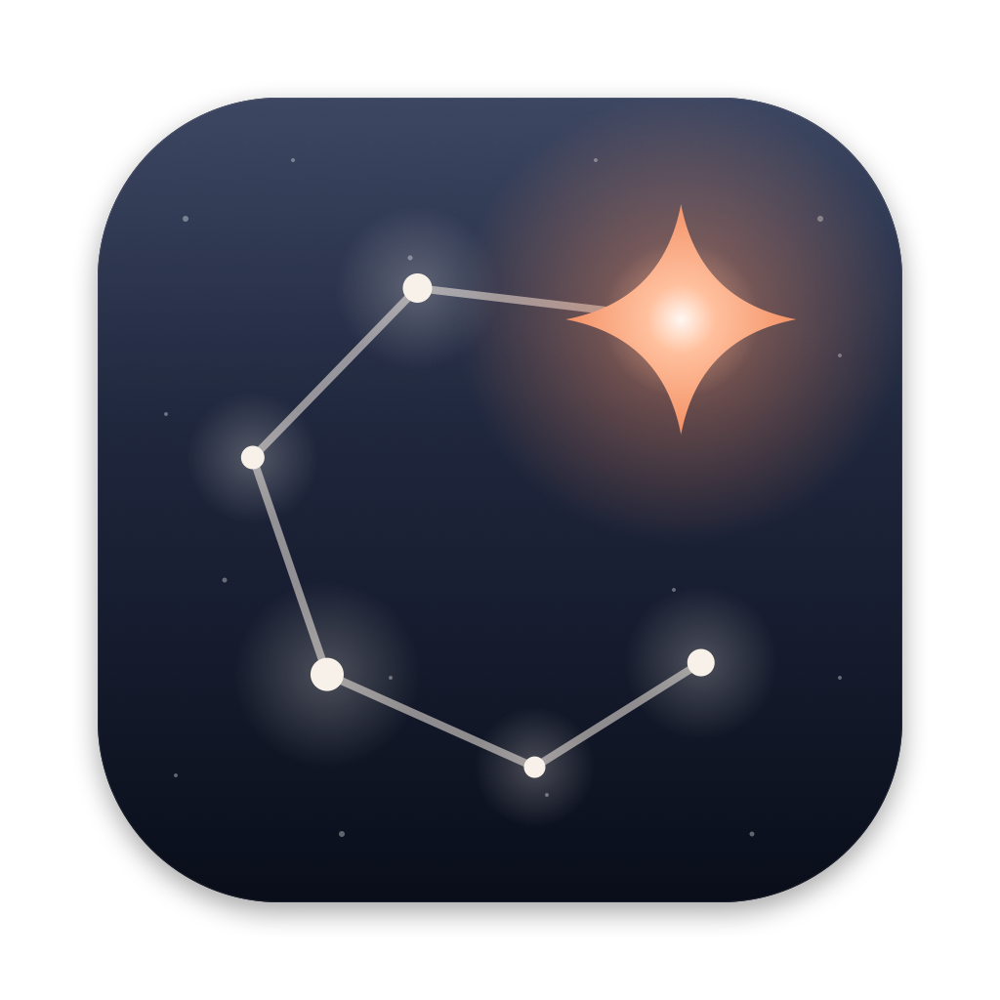
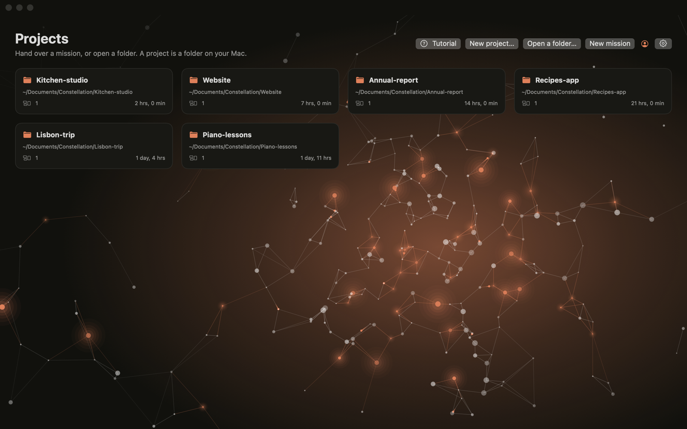
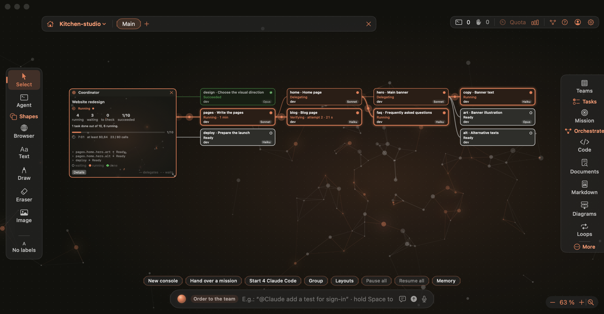
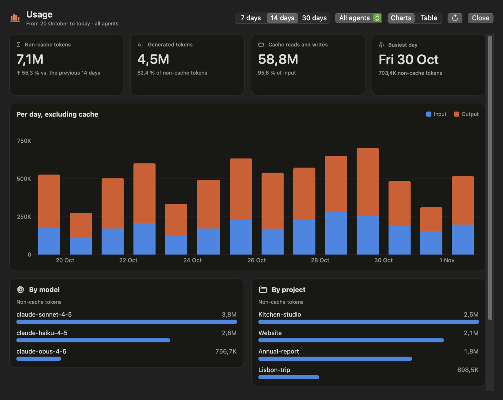
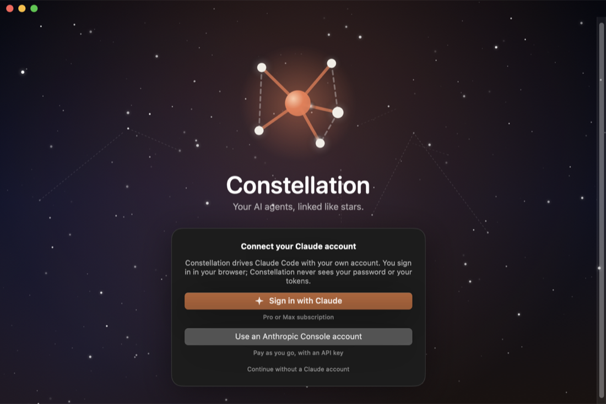
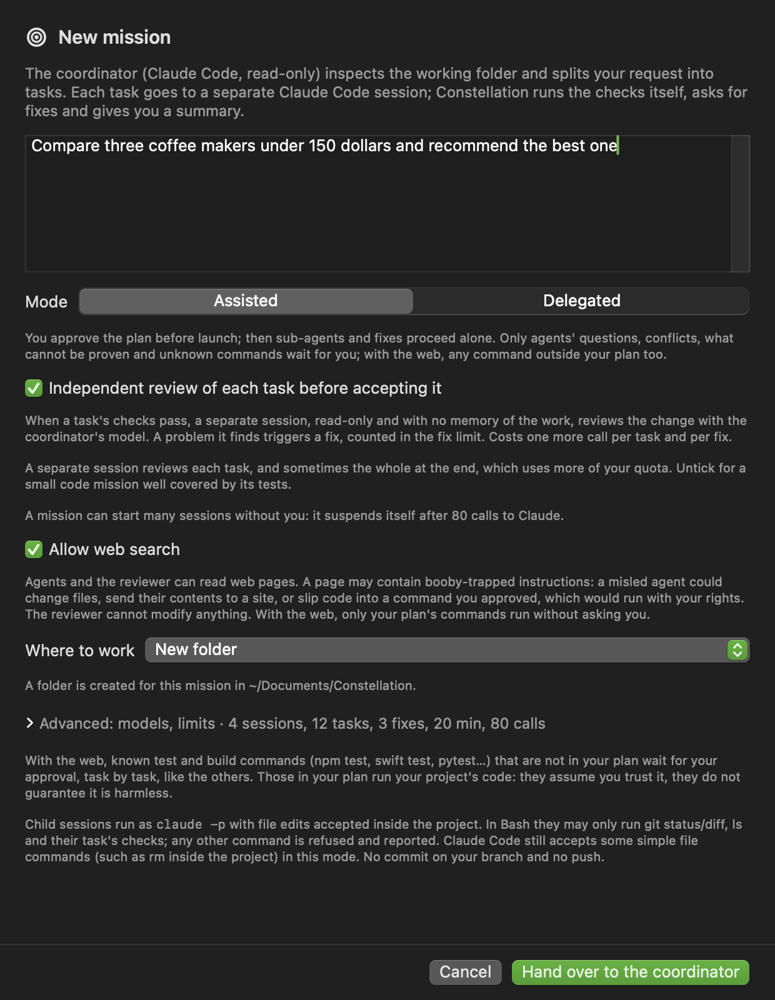
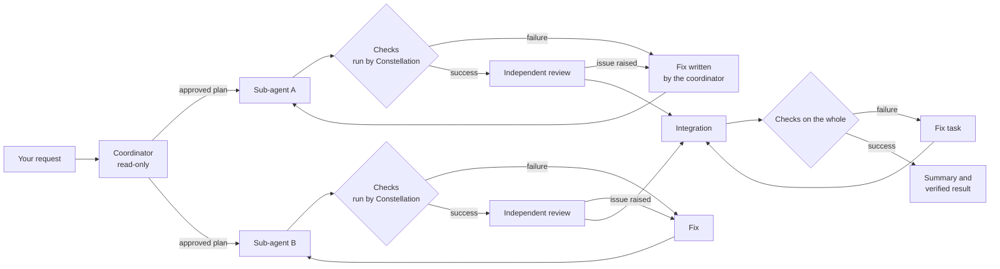
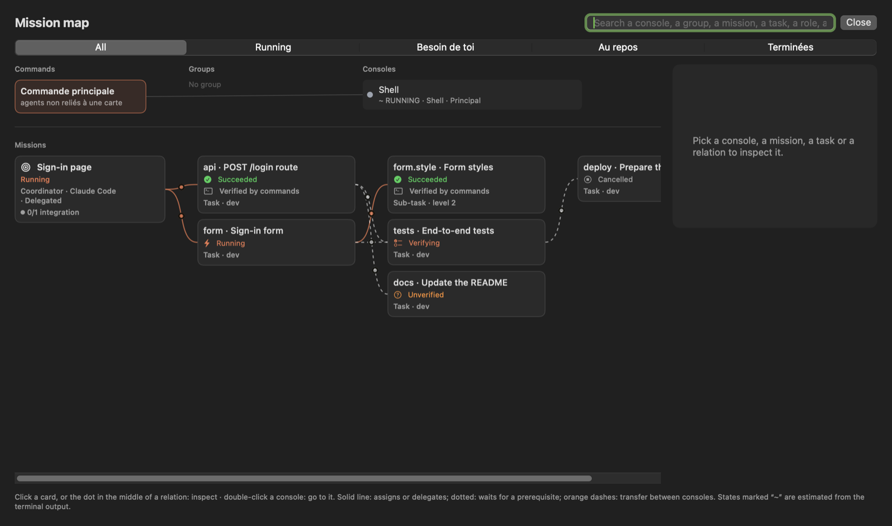

<p align="center"><a href="README.md">Français</a> · English</p>

<p align="center">
  
</p>

<h1 align="center">Constellation</h1>

<p align="center">
  <strong>A macOS workspace that puts your AI agents on one board,<br>
  to code, research, write or analyze, and hands a request to a coordinator that splits it up and checks the result.</strong>
</p>

<p align="center">
  
  
  
  <a href="https://github.com/r97sgkjtdh-ops/constellation/releases/latest"></a>
</p>

<p align="center">
  
</p>

<p align="center">
  
</p>

<p align="center"><sub>Screenshots of the app, with sample data.</sub></p>

---

## Contents

- [Overview](#overview)
- [Features](#features)
- [Requirements](#requirements)
- [Installation](#installation)
- [First launch and Claude account](#first-launch-and-claude-account)
- [Subscription, quotas and costs](#subscription-quotas-and-costs)
- [Getting started](#getting-started)
- [Missions in detail](#missions-in-detail)
- [Keyboard shortcuts](#keyboard-shortcuts)
- [Updates](#updates)
- [Data and privacy](#data-and-privacy)
- [Uninstalling](#uninstalling)
- [Troubleshooting](#troubleshooting)
- [Project status and known limits](#project-status-and-known-limits)
- [Reporting a problem](#reporting-a-problem)
- [License](#license)

## Overview

Command-line AI agents (Claude Code, Codex, Gemini CLI, OpenCode…) are powerful and are not only for programming: searching the web and citing sources, writing or proofreading a text, translating, analyzing data, organizing a plan. But each one runs in its own terminal, with no overall view. Constellation puts them on an **infinite board**, next to your notes, your files, your browser and your Git repository, and lets you make them work together.

Its central feature is the **mission**, for any subject. You write a request, a coordinator splits it into tasks, sub-agents carry them out, and the result is checked before it is declared successful. Agents can search the web (ticked by default for a new folder, unticked for an existing project) and write files (text, spreadsheet, page, code) in the working folder. This version does not generate images or videos. You can hand connectors to your agents, if you choose (see [Connectors](#connectors)).

Proof has three levels, shown as they are:
- **Verified by commands**: Constellation ran check commands itself, and their result proves the work. This is the strongest level.
- **Validated by review**: when no command can prove the result (a text, a search), a separate session judges each criterion.
- **Verified by commands and reviewed**: the commands passed and the independent review, on by default (you can untick it when creating a mission), also approved the work.

A review reduces errors but guarantees nothing: check what matters yourself. It also uses more quota, because it adds sessions.

Constellation is a native app (Swift and SwiftUI). It has no server and no account of its own: it drives the tools installed on your Mac, with **your own accounts**.

## Features

### Board and spaces
- Infinite board with zoom from 20 to 300% (steps of ×1.25 up to 100%), multiple selection, alignment guides, copy-paste and 80 levels of undo.
- Projects linked to a folder, and spaces in tabs: consoles keep running in the background.
- Automatic saving, previous version, hourly snapshots and archive.
- Colored notes, checklists, kanbans, calendar, hand-drawn shapes and arrows, pen and eraser.
- Annotatable images, and files or folders dropped from the Finder.
- **Moving around the board**: two fingers or the wheel move it in any direction, and a card scrolls only after you click inside it. Pinch and ⌘ + wheel zoom around the pointer; right-button drag also moves the board, and a slight bounce marks the edges. The + and − buttons zoom in steps.
- **Living background**: an animated network in the background gives life to the home screen and the board. "Reduce animations" freezes it.
- **Movable mission tasks**: on the board, drag a mission's tasks (and their sub-agents) to arrange them as you like. They follow the coordinator card, and a right-click puts them back in place automatically.
- **Progress bars** for the agent of each Claude Code console and each of its sub-agents: the agent's task list (2/5 tasks and the current task) when it keeps one, otherwise the number of steps (each tool used) and the time spent. Without a task list the bar is an estimate: it only reaches the end once the work is done.

### Consoles and agents
- Real terminals (PTY): Ctrl-C, full-screen interfaces, 256 colors and truecolor, 10,000 lines of history.
- Catalog of about 25 CLIs detected automatically (Claude Code, Codex, Gemini, OpenCode…), plus your custom agents.
- Pause, resume, restart, duplicate and switch CLI. The previous conversation is resumed when the CLI allows it.
- State of each console (working, waiting for permission, done…), precise for Claude Code thanks to its hooks.
- Separate profiles for Claude Code (`CLAUDE_CONFIG_DIR`) and Codex (`CODEX_HOME`).

### Coordination
- Named, colored **groups**, with roles (frontend, backend, tests, review, documentation, security…).
- **Command bar** (⌘K): `@console` and `@group` mentions, natural-language orders ("create 4 Codex agents") and a plan approved before sending.
- **Relays**: handoff to a new console with a summary, and forwarding of replies from one console to others.
- **Loops**: an instruction re-run at a regular interval or at the end of each turn, until a verified goal (exit code or verdict).
- Shared project **memory**, built by a read-only reading of the code and passed to the consoles.

### Missions
- A read-only coordinator proposes a plan, approved before anything runs.
- Sub-agents work in your folder or each in an isolated **Git worktree**.
- Checks run by Constellation, fixes written by the coordinator and an independent review, on by default.
- An all-or-nothing integration, then a check of the whole.
- Cascading delegation, within budgets you set.
- **New mission** starts from the home screen: Constellation then creates a folder in `~/Documents/Constellation` (with a numeric suffix if the name is taken). Git stays discreet: the branch and isolation choice appears only inside a Git repository.
- **Deliverables**: one click opens only a regular, non-executable file of a document type; otherwise it is shown in the Finder.
- **Robust missions**: an agent that crashes, returns an error or runs out of time is restarted automatically (2 automatic tries, in its own conversation when known) while the others finish their work. "Resume" restarts the tasks interrupted when Constellation was closed, and a blocked task restarts as soon as the task it depends on has succeeded.
- **History**: the **Missions** button on the home screen finds every mission, with a search. You can reopen one, run it again, copy its result or save it (keys are masked).
- Details in [Missions in detail](#missions-in-detail).

### Mission map
- A single view of consoles, missions, tasks and subtasks, and of what links them (delegates, waits, handoff, forward).
- Search and filters, a sheet for each task, an explanation of each relation.

### Studios
- **Code**: file tree, editor with syntax highlighting, search, and an alert when an agent changes the open file.
- **Markdown**: note vault, automatic saving, link graph and the project's Claude memory.
- **Documents**: long-document generation, per-project library, PDF export (cover, table of contents, bookmarks).
- **Diagrams**: generation as editable shapes on the board, PNG and Excalidraw export.

### Git and browser
- Git panel: branch, changes, history, commit of chosen files, push and pull. Discarded changes are copied aside first.
- Branch map, and GitHub connection through `gh`.
- Built-in browser (WebKit): 12 tabs, desktop and mobile sizes, usual local ports detected.

### Usage
- Tokens per day, per model and per project, read from the local logs of Claude Code and Codex, as a chart or a table.
- **Claude subscription quota** in the top bar: share used of the 5-hour session and of the week, with the reset time; on hover or in the Usage page, the share remaining. The figures come from Claude Code itself and refresh when a Claude Code console on the board receives a reply.

<p align="center">
  
</p>

### Voice
- Voice command (hold the space bar) and dictation in consoles (Fn key).
- Transcription happens **on the Mac**: the audio is sent nowhere.

### Customization
- Interface in French or English, and language of the agents' replies.
- Light and dark themes, accent color, backgrounds, sizes and reduced animations.

## Requirements

| | |
|---|---|
| **System** | macOS 14 Sonoma or later |
| **Processor** | Apple Silicon or Intel: released versions are universal. |
| **For missions** | [Claude Code](https://docs.anthropic.com/claude-code), signed in to a Claude subscription (Pro or Max) or an Anthropic Console account |
| **Optional** | Git (isolated missions, Git panel), [`gh`](https://cli.github.com) (GitHub), any other CLI you want to use as consoles |

At the very start of launch, Constellation checks that the system is macOS 14 or later. If not, it explains why and quits, without reading or changing any data.

## Installation

1. Open the [**Releases**](https://github.com/r97sgkjtdh-ops/constellation/releases/latest) page and download `Constellation-<version>.zip`.
2. Open the archive, then drag **Constellation.app** into the **Applications** folder.
3. Launch Constellation from the Applications folder or Launchpad.

> [!IMPORTANT]
> **First launch.** Constellation is not yet signed with an Apple developer certificate or notarized. At first launch macOS therefore shows "Apple could not verify…" and refuses to open it. To allow it, once:
>
> 1. Open **System Settings › Privacy & Security**.
> 2. At the bottom, on the line mentioning Constellation, click **Open Anyway**, then confirm.
>
> You can also do it in Terminal:
>
> ```bash
> xattr -dr com.apple.quarantine /Applications/Constellation.app
> ```
>
> Only do this for an archive downloaded from this repository's official Releases page.

Later versions are installed from the app itself, after their signature is checked (see [Updates](#updates)).

### Installing Claude Code

If Claude Code is not yet on your Mac, Constellation tells you at launch and shows the install command:

```bash
curl -fsSL https://claude.ai/install.sh | bash
```

If `claude` is installed somewhere unusual, enter its path in **Settings › Agents**.

## First launch and Claude account

<p align="center">
  
</p>

Constellation uses **the Claude account of the person using it**, never anyone else's. At first launch, the sign-in page offers three choices:

| Choice | For whom |
|---|---|
| **Sign in with Claude** | A Claude Pro or Max subscription |
| **Use an Anthropic Console account** | Pay-as-you-go billing, by API key |
| **Continue without a Claude account** | Use only the shell consoles and the other CLIs. Missions need Claude Code. |

- Sign-in goes through `claude auth login` and happens **in your browser**. If the page shows a code, paste it into Constellation.
- Constellation sees neither your password nor your tokens: they stay managed by Claude Code.
- If you are already signed in to Claude Code in the terminal, Constellation recognizes it and opens the board directly.
- **To sign out**, click the account icon at the top right, next to the settings, then **Sign out of Claude…**. You can also use **Settings › Accounts** or the **Constellation › Sign out of Claude…** menu. This also signs Claude Code out in the terminal; your boards and missions are kept.
- **To switch accounts**, sign out, then sign in again.

An assistant then offers you the appearance, a first project and your default agent.

## Subscription, quotas and costs

**Constellation does not sell credits and does not bill model calls.** It launches the CLIs with the sign-in configured for each of them. Model usage therefore depends on your account with the provider.

| Sign-in used by Claude Code | What a mission uses |
|---|---|
| **Claude Pro or Max** subscription | The quotas included in your subscription. An estimated dollar amount in a log does not automatically match an extra charge. |
| **Anthropic Console / API key** account | Usage billed to the associated API account, according to its pricing and credits. |
| Paid extra usage enabled | Extra charges may apply depending on your account's settings and limits. |

The coordinator, sub-agents, reviews and fixes all use the model. Several agents do not mean several subscriptions: they can use up the limits of the same account.

**Reading amounts correctly.** Claude Code can compute a monetary estimate from the tokens used. This amount is an estimate reported by the CLI: it is neither a bank charge nor a guaranteed price per mission. For a subscription, watch the usage limits; for the API, check the provider's billing.

A configured `ANTHROPIC_API_KEY` can make Claude Code use API billing instead of the subscription. Having Pro is therefore not enough to tell which sign-in is actually used. Check the account in Claude Code and your subscription's extra-usage options. Constellation's limits on tasks, duration and parallelism are not a guaranteed billing cap.

References: [Claude Code with Pro or Max](https://support.claude.com/en/articles/11145838-use-claude-code-with-your-pro-or-max-plan) · [Understanding cost estimates](https://code.claude.com/docs/en/costs).

## Getting started

1. **Open a project**: ⌘O, or drag a folder onto the home screen. A project matches a folder on your disk.
2. **Add a console**: right-click the board, or ⌘K then "create 2 Claude agents". Each console is a real terminal in the project folder.
3. **Talk to your agents**: ⌘K opens the command bar. `@name instruction` sends a message to a console, `@group instruction` to a whole team.
4. **Hand over a mission**: the **New mission** button on the home screen (no project needed, in a new folder), the **Mission** button (the target) in the left bar, or "Hand over a mission" on an empty board. Describe the expected result and the check commands (for example `swift test` or `npm test`), choose the mode, then start.
5. **Follow progress**: the coordinator card and its tasks appear on the board. The **mission map** (X key) shows the whole.

The built-in tutorial (⌘?) explains each button.

### Example request for a first mission

Start with a small throwaway project and **assisted** mode, to read the plan before it runs. Here is an example to adapt to the files and commands actually in your project:

```text
Goal: fix the addition and multiplication functions of this Python project.

Scope: addition.py and multiplication.py.
Expected result: the operations also work with zero and negative numbers.
Constraints: do not delete any existing test and do not change the expected results
to hide a defect. Add no dependency.

Split the fixes into separate tasks. Each task must have its own check.
After integration, run python3 -m unittest -v on the whole project.
In the summary, list the modified files, the checks run and their results.
If information is missing, ask a question instead of inventing it.
```

Read the proposed plan: the tasks, their scope, their dependencies and their check commands must match your request. The independent review is on by default: untick it only for a small mission well covered by its tests. Once the mission is done, examine the Git diff and the outputs of the checks before keeping the result.

A mission marked "Succeeded and verified" means its checks passed on the tested state. It does not guarantee the absence of bugs those checks do not cover.

## Missions in detail

<p align="center">
  
</p>



### How it runs
1. **Plan.** A read-only Claude Code coordinator studies the project and proposes tasks, with their dependencies, files and checks. Constellation validates this plan (keys, dependencies, no cycles, number of tasks) before anything runs.
2. **Execution.** Each task is given to a separate Claude Code session, which receives the original request, its instructions, its files, the results of its prerequisites and the checks that will judge it.
3. **Checks.** Constellation runs the check commands itself. On failure, the coordinator writes a fix from the real output, and the task receives it in the same conversation.
4. **Review (on by default).** An independent session, with no memory of the work, rereads each change whose checks passed.
5. **Integration and final check.** Verified contributions are integrated, then the checks on the whole are run. If they fail, a fix task is created.
6. **Summary.** It says exactly what was proven, and what was not.

### Modes
- **Assisted**: you read and edit the plan, then approve it. Sub-agents and fixes then go on their own, within the set limits. Only these wait for you: agents' questions, conflicts, what cannot be proven and unknown commands; with the web, any command outside your plan.
- **Delegated**: everything starts automatically, within the limits you set.

By default, a mission is limited to 3 simultaneous sessions, 12 tasks, 3 fixes per task, 20 minutes per session and 80 Claude calls (sessions, reviews, written fixes, plan and summary). In the advanced settings you can also set a maximum spending: at that amount no new session starts, and running ones finish, so it can be exceeded. At the call limit it suspends: what is running finishes, then nothing restarts until you untick "Suspend", which grants it 40 more calls. These limits are set in New mission › Advanced settings, where you also choose the models for the coordinator and the tasks. By default ("Per task"), the coordinator picks Haiku, Sonnet or Opus for each task, the cheapest that suffices; this choice is indicative and you can force a model. Fable is used only if you choose it and your access is verified; otherwise Opus replaces it. You can choose a model there for the coordinator, the tasks and the review, which follows the coordinator's by default.

The cost shown is a minimum ("at least $1.20"): an interrupted session does not report its own.

With the web on, a booby-trapped page can fool an agent: it could modify files, send their content to a site, or slip code into a command you approved. Only the commands in your plan then run without asking you.

### Isolation
- **Shared folder**: tasks work in your folder. Those that declare the same files run one after the other.
- **One worktree per task** (if the project is a Git repository): each task works in a separate worktree, created from the current state of your folder. Your folder is not modified during the mission. Each verified contribution becomes a patch applied **entirely or not at all**. On conflict, your folder stays intact, and the patch and the worktree are kept for you to decide.
- Constellation **never commits to your branch and never pushes**.

### Guarantees
- **Proof tied to the tested state.** Each proof is tied to the exact content of the checked files: revision, changes and untracked files. If that content changes before integration, the checks are re-run.
- **Exact permissions.** Known test and build commands run on their own, except with the web or a connector: only the commands in your approved plan and plain reads of the folder then pass without asking (in delegated mode, only those reads, unless you ticked the permission). With no web or connector, and with the sandbox, that box is ticked by default: the project's code, even cloned, can then run without asking, in the sandbox, with the network open. The others wait for your approval, and a modified command is no longer approved.
- **Honest states.** "Succeeded and verified" requires that every task passed its checks and the whole passed its own. A mission judged by a review is shown as "Succeeded, validated by review", never "verified"; commands and review together give "Succeeded, verified and reviewed". A task you accept yourself is shown as "Accepted by you", never "verified".
- **Reliable cancellation.** Cancelling stops sessions, checks, reviews and integration, with the whole tree of their processes.
- **No hidden restart.** After the app is closed, running tasks become "to recover" and wait for an explicit restart.
- **Lighter sessions.** Mission sessions start without loading your MCP servers or skills, to limit the context sent to the model. Only the connectors you tick are an exception (see [Connectors](#connectors)); with none ticked, nothing changes. This can reduce token use; the gain depends on the task, the model and the fixes needed. Amounts estimated by the CLI are not proof of billing: see [Subscription, quotas and costs](#subscription-quotas-and-costs).

### Connectors
In New mission, the **Connectors** section lists the ones Claude Code knows for that folder. You can hand some to your agents, as you choose.

- **Nothing is ticked by default**, and your choice is not carried over from one mission to the next. The **Skills** box is separate, also unticked.
- **Only agents and their sub-agents** receive the ticked connectors. The coordinator and the reviewer get none.
- **Every connector counts as able to write.** Constellation cannot know which of a connector's tools change data: a sentence says so as soon as a connector is ticked, and each agent session uses a little more.
- **A connector that is not connected is greyed out**, with its state. Constellation does not sign it in: do that in Claude Code.
- **An explicit agreement** is asked at launch when a connector is combined with the web, or when the mission is in delegated mode. It is not remembered. In assisted mode without the web, approving the plan counts as agreement.
- **A connector is an untrusted source**, like the web: an e-mail or a page may contain booby-trapped instructions. In assisted mode, with a connector, only the commands of your approved plan run without asking you.
- **Actions done through a connector are marked "unverified"** and listed in the mission: Constellation cannot check them.

### Cascading delegation
An agent that needs help creates a sub-agent, which can create its own: each appears on the board. Constellation validates them within a budget of levels (4 by default in New mission, 6 at most) and of number of tasks, has them carried out and checked, then hands control back to the parent with their results so it can consolidate. In assisted mode, you approve the starting plan; sub-agents and fixes follow without a new question, and Claude Code's native sub-agent tool is disabled in missions so that nothing happens off the board.

### Mission map

<p align="center">
  
</p>

Click a card to inspect it, or the dot in the middle of a relation to learn what it is for and where it stands. Solid lines mean a task is delegated, dotted lines that it waits for a prerequisite, and orange dashes a forward between consoles.

## Keyboard shortcuts

| Shortcut | Action |
|---|---|
| ⌘K | Command bar |
| ⌘O | Open a folder as a project |
| ⇧⌘T | New space |
| ⌘1 … ⌘9 | Go to space 1 to 9 |
| ⇧⌘H | Back to home |
| ⌘+ / ⌘− / ⌘0 | Zoom in, zoom out, actual size |
| ⌘G / ⇧⌘G | Group, ungroup |
| ⌘D | Duplicate the selection |
| V | Selection tool |
| T | New console at the pointer |
| N | Go to the agent asking for attention |
| P · E | Pen · eraser |
| X | Mission map |
| G | Git panel |
| M · S · L | Memory · skills · loops |
| D | Markdown studio |
| ⇧1 | Fit everything |
| Arrows (⇧: 10 pt) | Move the selection |
| Tab · ⇧Tab · ⌥ Arrows · Return | Move from card to card · open the card |
| In a kanban: ↑ then arrows · Return · Escape · ⌥ ← → | Walk the tickets · edit · close the editor · change column |
| In a calendar: arrows · Return · Escape · ⇧ Return | Walk the days · open (again: the next event) · close the editor · add an event |
| ⌫ · Esc | Delete the selection · back to selection, then deselect all |
| Held Space | Voice command (when the board has the keyboard) |
| Held Fn | Dictation in the active console or field |
| ⌘? | Tutorial |
| ⌘, | Settings |

Single-key shortcuts work when the board has the keyboard, and can be changed in **Settings › Shortcuts**.

## Updates

Constellation checks for an update at launch, then every 6 hours (adjustable). A version found shows as a red dot on the Settings button; installing stays your choice. You can also use **Settings › About › Updates** or the **Constellation › Check for Updates…** menu. When a version is available, a badge appears in the top bar.

The archive is installed only if its **Ed25519 signature** matches the key built into the app. The download is limited to GitHub's servers, and the app's identifier, version and code signature are checked.

The old version is kept in `~/Library/Application Support/Constellation-sauvegardes/`. An update is refused while mission sessions are running.

## Data and privacy

- **No Constellation server.** The app sends no statistics or telemetry. Its only connections are the update check on the GitHub API (can be turned off), the pages you open in the built-in browser, and what the CLIs you launch do, which follow their own terms.
- **No credentials kept.** Accounts stay managed by Claude Code, Codex, `gh`, etc.
- **Where your data is:**

| Location | Content |
|---|---|
| `~/Library/Application Support/Constellation/` | Boards, missions, patches, forwards, update logs |
| `~/Library/Preferences/com.vel.constellation.plist` | Settings |
| `<your project>/.constellation/` | Handoff summaries, copies of discarded changes |
| `~/Library/Application Support/Constellation-sauvegardes/` | Old app versions and copies of your data, made at each install |

## Uninstalling

1. Quit Constellation (⌘Q). If you wish, sign out of Claude first (Settings › Accounts).
2. Move `/Applications/Constellation.app` to the Trash.
3. To also erase your data and settings (this is **permanent**):

```bash
rm -rf ~/Library/Application\ Support/Constellation
rm -rf ~/Library/Application\ Support/Constellation-sauvegardes
defaults delete com.vel.constellation
```

Claude Code and the other CLIs are not touched: they are uninstalled separately.

## Troubleshooting

<details>
<summary><strong>"Apple could not verify that Constellation is free of malware"</strong></summary>

The app is not yet notarized. Go to **System Settings › Privacy & Security** and click **Open Anyway**, or run `xattr -dr com.apple.quarantine /Applications/Constellation.app` (see [Installation](#installation)).
</details>

<details>
<summary><strong>"Claude Code is not installed" even though it is</strong></summary>

Constellation looks for `claude` using the `PATH` of your login shell. If your install is elsewhere, enter the full path in **Settings › Agents**, then click **Check again**. You can check your install with `claude --version` and `claude auth status --text`.
</details>

<details>
<summary><strong>Sign-in does not complete</strong></summary>

- If the browser did not open, click **Reopen page** or **Copy link**.
- If the page shows a code, paste it into the field provided, then click **Confirm**.
- If nothing works, sign in in Terminal with `claude auth login`, then come back to Constellation: the sign-in is recognized automatically.
</details>

<details>
<summary><strong>A mission fails with a usage limit (error 429)</strong></summary>

Your Claude subscription limit has been reached. The exact reason is shown in the task. An agent task then stops without failing and resumes the same conversation by itself at the announced time. If the plan or a review is hit, wait for the reset, then run it again.
</details>

<details>
<summary><strong>Voice command or dictation does not work</strong></summary>

Allow the microphone and speech recognition in **System Settings › Privacy & Security**. If the Fn key opens the emoji picker, change its role in System Settings › Keyboard, or choose another key in **Settings › Voice**.
</details>

<details>
<summary><strong>Attaching a diagnostic to a report</strong></summary>

Menu **Help › Export Diagnostic…**: Constellation creates a `.zip` archive where you choose. It contains the app and macOS versions, the Mac model, the app settings (keys and tokens are masked), the current session log, the list of data files (without their content) and the update logs. Your home folder path and user name are replaced. **Nothing is sent**: read the archive, then attach it to your issue if you wish.
</details>

<details>
<summary><strong>Going back to the previous version</strong></summary>

Open the most recent dated folder in `~/Library/Application Support/Constellation-sauvegardes/` and follow its `RESTAURER.txt` file.
</details>

## Project status and known limits

Constellation is under active development. The main limits:

- **No image or video generation yet.** No date is promised.
- **Missions only work with Claude Code.** The other CLIs are used as consoles but have no mission adapter yet.
- **The app is neither signed by an Apple developer nor notarized.** You have to allow it at first launch.
- **Some features are still little tested in real conditions**: cascading delegation, fixes and cancellation. Automated tests cover neither the full interface journey nor real gestures on the board (trackpad, wheel, pinch).
- **You still need to check the agents' results yourself.** A "verified" mission is verified on the tested state, no further.
- **Worktree isolation does not cover everything.** Dependencies ignored by Git (`node_modules`, `.venv`) are shared by symbolic link, and databases, ports and services are not isolated.
- **Checks run in a macOS sandbox.** They write in the working folder, temporary folders and package caches, cannot read the most common keys and secrets (`~/.ssh`, `~/.aws`, the keychain…) and have no network if the mission uses the web or a connector. A box in the advanced settings turns it off. Git data, Claude's configuration and preferences are protected, and a check cannot launch apps. Key or password variables exported by your shell profile are removed, and what a check leaves running in the background is stopped when it ends (since 0.3.17, a process in its own session too, in a task's worktree and if it stays in that folder). It does not cover agent sessions, which have their own rules; other files on the Mac stay readable, and what a check writes in the folder or a cache can run later. Since 0.3.17, a subfolder holding a `.git` or a `CLAUDE.md` can no longer be moved during a check; a folder made elsewhere can still arrive with its own `.git`. It is one more barrier, not a guarantee.
- **The executable names of some catalog CLIs have not been verified.** For those that are missing, create a custom agent.

**What works and how it was checked**: missions are covered by 730 automated tests and real successful missions; the sandbox by tests with the real `sandbox-exec`; the keyboard inside cards (since 0.3.17) with real keys and real clicks sent by macOS; the update by a real move from 0.3.15 to 0.3.17 from the app.

**Still to check in real conditions**: VoiceOver, the confirmation dialogs added in 0.3.19, a forced stop during integration, the second-instance alert, the fish shell.

**Coming, with no date**: Apple signature and notarisation, image and video generation, other CLIs in missions.

## Reporting a problem

- **A bug or an idea**: open an [issue](https://github.com/r97sgkjtdh-ops/constellation/issues) with your macOS version, the Constellation version (Settings › About), the steps to reproduce, and what you expected. For a bug, attach a diagnostic if possible (menu **Help › Export Diagnostic…**).
- **A security flaw**: do not post it in a public issue. Use GitHub's private reporting (**Security › Report a vulnerability** tab), as explained in the [security policy](SECURITY.en.md).

This repository only holds the documentation and the released versions: the source code is not here.

## License

Constellation is created by **Vel**. It is proprietary software, free to use. Its source code is not published. The full terms are in [LICENSE](LICENSE), which is written in French only: you can install and use it freely, personally or professionally, but not redistribute, modify or decompile it.

Constellation is an independent project, with no link to Anthropic, OpenAI or Google. Claude and Claude Code are trademarks of Anthropic; the other names mentioned belong to their owners.
