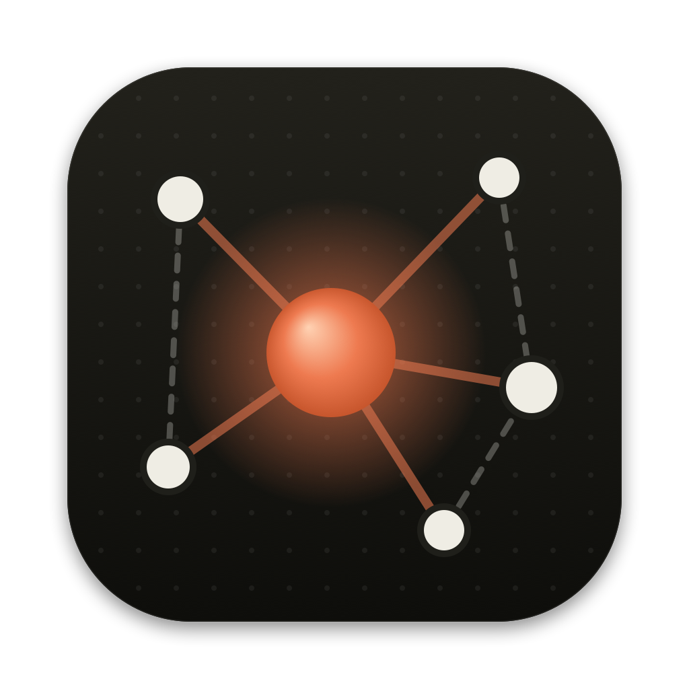
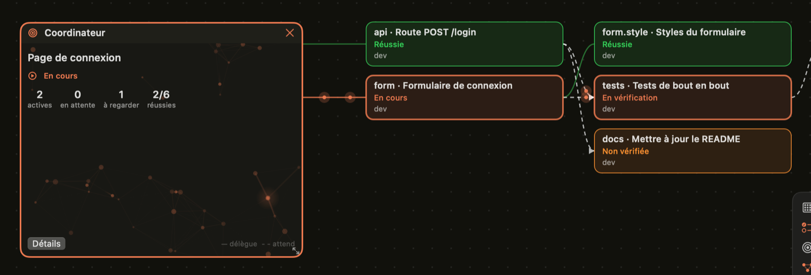
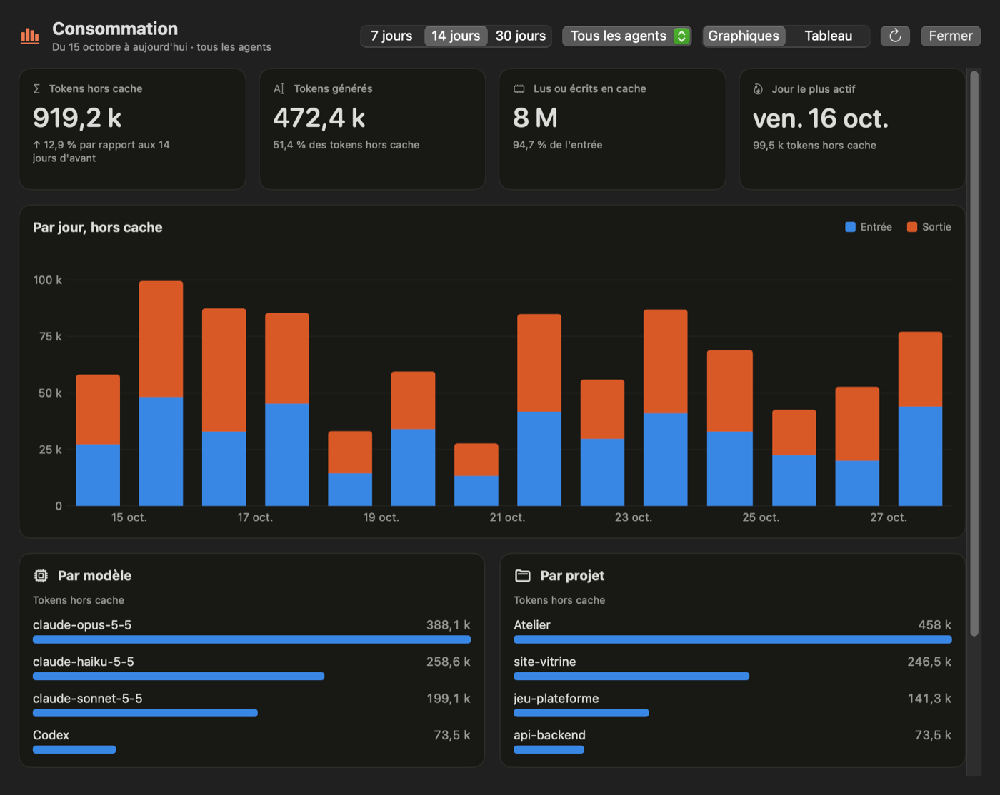
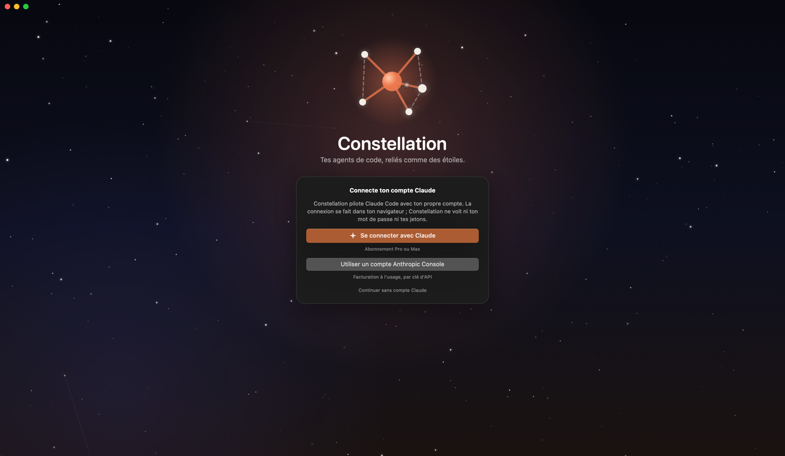
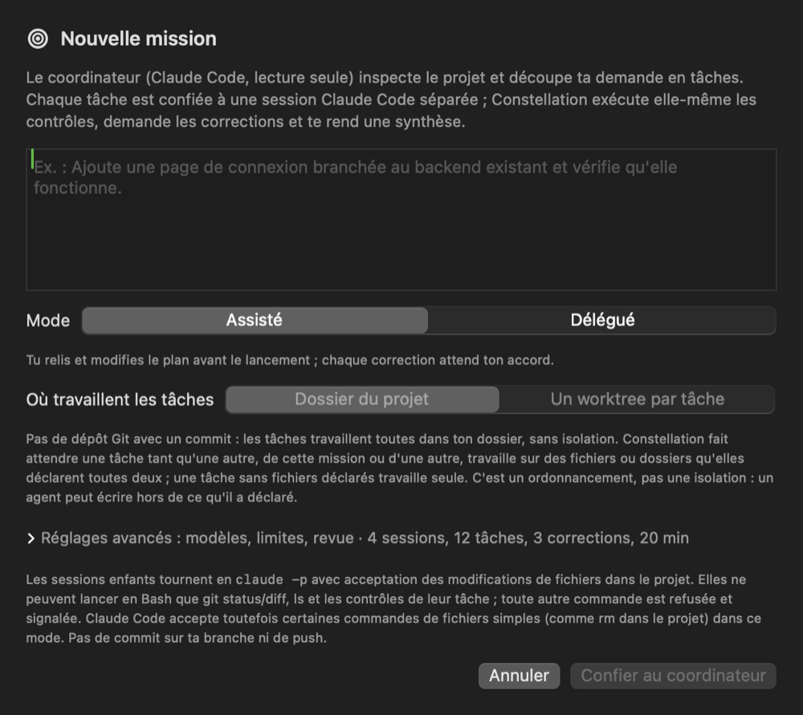
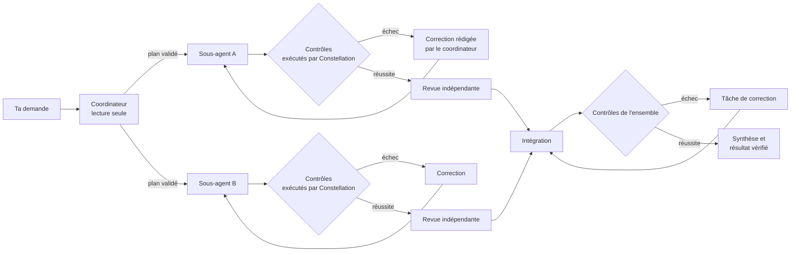
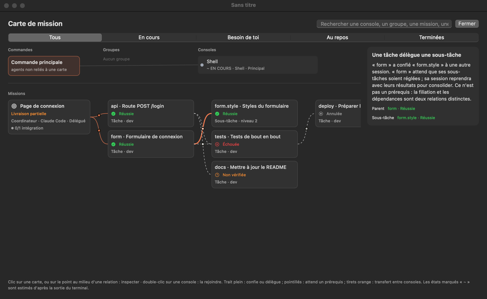

<p align="center">
  
</p>

<h1 align="center">Constellation</h1>

<p align="center">
  <strong>Un espace de travail pour macOS qui réunit tes agents de code sur un même tableau,<br>
  et confie une demande à un coordinateur qui la répartit, fait contrôler chaque résultat et livre un travail vérifié.</strong>
</p>

<p align="center">
  
  
  
  <a href="https://github.com/r97sgkjtdh-ops/constellation/releases/latest"></a>
</p>

<p align="center">
  
</p>

---

## Sommaire

- [Présentation](#présentation)
- [Fonctionnalités](#fonctionnalités)
- [Configuration requise](#configuration-requise)
- [Installation](#installation)
- [Premier lancement et compte Claude](#premier-lancement-et-compte-claude)
- [Abonnement, quotas et coûts](#abonnement-quotas-et-coûts)
- [Prise en main](#prise-en-main)
- [Les missions en détail](#les-missions-en-détail)
- [Raccourcis clavier](#raccourcis-clavier)
- [Mises à jour](#mises-à-jour)
- [Données et confidentialité](#données-et-confidentialité)
- [Désinstallation](#désinstallation)
- [Dépannage](#dépannage)
- [État du projet et limites connues](#état-du-projet-et-limites-connues)
- [Signaler un problème](#signaler-un-problème)
- [Licence](#licence)

## Présentation

Les agents de code en ligne de commande (Claude Code, Codex, Gemini CLI, OpenCode…) sont puissants, mais on les utilise chacun dans un terminal, sans vue d'ensemble. Constellation les pose sur un **tableau infini**, à côté de tes notes, de tes fichiers, de ton navigateur et de ton dépôt Git, et te permet de les faire travailler ensemble.

Sa fonction centrale est la **mission**. Tu écris une demande, un coordinateur la découpe en tâches, des sous-agents les réalisent, et **Constellation exécute elle-même les commandes de contrôle** avant de déclarer quoi que ce soit réussi. Ce qu'affirme un agent ne suffit jamais : seule une preuve compte.

Constellation est une application native (Swift et SwiftUI). Elle n'a pas de serveur ni de compte à elle : elle pilote les outils installés sur ton Mac, avec **tes propres comptes**.

## Fonctionnalités

### Tableau et espaces
- Tableau infini avec zoom de 20 à 300 %, sélection multiple, repères d'alignement, copier-coller et annulation sur 80 étapes.
- Projets reliés à un dossier, et espaces en onglets : les consoles continuent de tourner en arrière-plan.
- Sauvegarde automatique, version précédente, instantanés horaires et archive.
- Notes colorées, checklists, kanbans, calendrier, formes et flèches au rendu dessiné à la main, stylo et gomme.
- Images annotables, et fichiers ou dossiers déposés depuis le Finder.

### Consoles et agents
- Vrais terminaux (PTY) : Ctrl-C, interfaces en plein écran, couleurs 256 et truecolor, 10 000 lignes d'historique.
- Catalogue d'environ 25 CLI détectés automatiquement (Claude Code, Codex, Gemini, OpenCode…), plus tes agents personnalisés.
- Pause, reprise, redémarrage, duplication et changement de CLI. La conversation précédente est reprise quand le CLI le permet.
- État de chaque console (au travail, en attente d'autorisation, terminé…), précis pour Claude Code grâce à ses hooks.
- Profils séparés pour Claude Code (`CLAUDE_CONFIG_DIR`) et Codex (`CODEX_HOME`).

### Coordination
- **Groupes** nommés et colorés, avec des rôles (frontend, backend, tests, revue, documentation, sécurité…).
- **Barre de commande** (⌘K) : mentions `@console` et `@groupe`, ordres en langage naturel (« crée 4 agents Codex ») et plan validé avant l'envoi.
- **Relais** : handoff vers une nouvelle console avec un résumé, et transfert de réponses d'une console à d'autres.
- **Boucles** : une consigne relancée à intervalle régulier ou à chaque fin de tour, jusqu'à un objectif vérifié (code de sortie ou verdict).
- **Mémoire** partagée du projet, construite par une lecture du code en lecture seule et transmise aux consoles.

### Missions
- Un coordinateur en lecture seule propose un plan, validé avant toute exécution.
- Des sous-agents travaillent dans ton dossier ou chacun dans un **worktree Git** isolé.
- Des contrôles exécutés par Constellation, des corrections rédigées par le coordinateur et une revue indépendante (option).
- Une intégration tout ou rien, puis le contrôle de l'ensemble.
- Une délégation en cascade, dans des budgets que tu fixes.
- Détails dans [Les missions en détail](#les-missions-en-détail).

### Carte de mission
- Une vue unique des consoles, des missions, des tâches et des sous-tâches, et de ce qui les relie (confie, délègue, attend, handoff, transfert).
- Recherche et filtres, fiche de chaque tâche, explication de chaque relation.

### Studios
- **Code** : arborescence, éditeur avec coloration, recherche et alerte quand un agent modifie le fichier ouvert.
- **Markdown** : coffre de notes, sauvegarde automatique, graphe des liens et mémoire Claude du projet.
- **Documents** : génération de documents longs, bibliothèque par projet, export PDF (couverture, sommaire, signets).
- **Diagrammes** : génération en formes modifiables sur le tableau, export PNG et Excalidraw.

### Git et navigateur
- Panneau Git : branche, modifications, historique, commit des fichiers choisis, push et pull. Les changements annulés sont d'abord copiés de côté.
- Carte des branches, et connexion à GitHub via `gh`.
- Navigateur intégré (WebKit) : 12 onglets, tailles ordinateur et mobile, ports locaux usuels détectés.

### Consommation
- Tokens par jour, par modèle et par projet, lus dans les journaux locaux de Claude Code et de Codex, en graphique ou en tableau.

<p align="center">
  
</p>

### Voix
- Commande vocale (barre d'espace maintenue) et dictée dans les consoles (touche Fn).
- La transcription se fait **sur le Mac** : le son n'est envoyé nulle part.

### Personnalisation
- Interface en français ou en anglais, et langue des réponses des agents.
- Thèmes clair et sombre, couleur d'accent, fonds, tailles et animations réduites.

## Configuration requise

| | |
|---|---|
| **Système** | macOS 14 Sonoma ou plus récent |
| **Processeur** | Apple Silicon (M1 ou plus récent). Les versions publiées sont compilées pour arm64 seulement. |
| **Pour les missions** | [Claude Code](https://docs.anthropic.com/claude-code), connecté à un abonnement Claude (Pro ou Max) ou à un compte Anthropic Console |
| **Facultatif** | Git (missions isolées, panneau Git), [`gh`](https://cli.github.com) (GitHub), les autres CLI que tu veux utiliser comme consoles |

Au tout début du lancement, Constellation vérifie que le système est bien macOS 14 ou plus récent. Sinon, elle explique pourquoi et se ferme, sans lire ni modifier aucune donnée.

## Installation

1. Ouvre la page [**Releases**](https://github.com/r97sgkjtdh-ops/constellation/releases/latest) et télécharge `Constellation-<version>.zip`.
2. Ouvre l'archive, puis glisse **Constellation.app** dans le dossier **Applications**.
3. Lance Constellation depuis le dossier Applications ou le Launchpad.

> [!IMPORTANT]
> **Premier lancement.** Constellation n'est pas encore signée avec un certificat de développeur Apple ni notarisée. Au premier lancement, macOS affiche donc « Apple n'a pas pu vérifier… » et refuse de l'ouvrir. Pour l'autoriser, une seule fois :
>
> 1. Ouvre **Réglages Système › Confidentialité et sécurité**.
> 2. En bas, à la ligne qui mentionne Constellation, clique sur **Ouvrir quand même**, puis confirme.
>
> Tu peux aussi, dans le Terminal :
>
> ```bash
> xattr -dr com.apple.quarantine /Applications/Constellation.app
> ```
>
> Ne le fais que pour une archive téléchargée depuis la page Releases officielle de ce dépôt.

Les versions suivantes s'installent depuis l'application elle-même, après vérification de leur signature (voir [Mises à jour](#mises-à-jour)).

### Installer Claude Code

Si Claude Code n'est pas encore sur ton Mac, Constellation te le dit au lancement et affiche la commande d'installation :

```bash
curl -fsSL https://claude.ai/install.sh | bash
```

Si `claude` est installé à un endroit inhabituel, indique son chemin dans **Réglages › Agents**.

## Premier lancement et compte Claude

<p align="center">
  
</p>

Constellation utilise **le compte Claude de la personne qui l'utilise**, jamais celui d'un autre. Au premier lancement, la page de connexion propose trois choix :

| Choix | Pour qui |
|---|---|
| **Se connecter avec Claude** | Un abonnement Claude Pro ou Max |
| **Utiliser un compte Anthropic Console** | Une facturation à l'usage, par clé d'API |
| **Continuer sans compte Claude** | Utiliser seulement les consoles shell et les autres CLI. Les missions demandent Claude Code. |

- La connexion passe par `claude auth login` et se fait **dans ton navigateur**. Si la page affiche un code, colle-le dans Constellation.
- Constellation ne voit ni ton mot de passe ni tes jetons : ils restent gérés par Claude Code.
- Si tu es déjà connecté à Claude Code dans le terminal, Constellation le reconnaît et ouvre directement le tableau.
- **Pour te déconnecter**, va dans **Réglages › Comptes › Se déconnecter…** ou dans le menu **Constellation › Se déconnecter de Claude…**. Cela déconnecte aussi Claude Code dans le terminal ; tes tableaux et tes missions sont conservés.
- **Pour changer de compte**, déconnecte-toi, puis reconnecte-toi.

Un assistant te propose ensuite l'apparence, un premier projet et ton agent par défaut.

## Abonnement, quotas et coûts

**Constellation ne vend pas de crédits et ne facture pas les appels aux modèles.** Elle lance les CLI avec la connexion configurée pour chacun d'eux. L'utilisation du modèle dépend donc de ton compte auprès du fournisseur.

| Connexion utilisée par Claude Code | Ce que consomme une mission |
|---|---|
| Abonnement **Claude Pro ou Max** | Les quotas inclus dans ton abonnement. Un montant estimé en dollars dans un journal ne correspond pas automatiquement à une somme débitée en plus. |
| Compte **Anthropic Console / clé API** | Une utilisation facturée sur le compte API associé, selon sa tarification et ses crédits. |
| Usage supplémentaire payant activé | Des frais supplémentaires peuvent s'appliquer selon les réglages et limites de ton compte. |

Le coordinateur, les sous-agents, les revues et les corrections utilisent tous le modèle. Plusieurs agents ne donnent pas plusieurs abonnements : ils peuvent consommer les limites du même compte.

**Lire les montants correctement.** Claude Code peut calculer une estimation monétaire à partir des tokens utilisés. Les valeurs de 3,55 $ et 0,14 $ rapportées lors d'essais du projet étaient des montants remontés par le CLI, pas des débits bancaires vérifiés ni une promesse de prix par mission. Pour un abonnement, surveille les limites d'usage ; pour l'API, consulte la facturation du fournisseur.

Une clé `ANTHROPIC_API_KEY` configurée peut faire utiliser la facturation API plutôt que l'abonnement. Avoir Pro ne suffit donc pas à identifier la connexion effectivement utilisée. Vérifie le compte dans Claude Code et les options d'usage supplémentaire de ton abonnement. Les limites de tâches, de durée et de parallélisme de Constellation ne sont pas un plafond garanti de facturation.

Références : [Claude Code avec Pro ou Max](https://support.claude.com/en/articles/11145838-use-claude-code-with-your-pro-or-max-plan) · [Comprendre les estimations de coût](https://code.claude.com/docs/en/costs).

## Prise en main

1. **Ouvre un projet** : ⌘O, ou glisse un dossier sur l'accueil. Un projet correspond à un dossier de ton disque.
2. **Ajoute une console** : clic droit sur le tableau, ou ⌘K puis « crée 2 agents Claude ». Chaque console est un vrai terminal dans le dossier du projet.
3. **Parle à tes agents** : ⌘K ouvre la barre de commande. `@nom consigne` envoie un message à une console, `@groupe consigne` à toute une équipe.
4. **Confie une mission** : bouton **Mission** (la cible) dans la barre de gauche, ou « Confier une mission » sur un tableau vide. Décris le résultat attendu et les commandes de contrôle (par exemple `swift test` ou `npm test`), choisis le mode, puis lance.
5. **Suis l'avancement** : la carte du coordinateur et ses tâches s'affichent sur le tableau. La **carte de mission** (touche X) montre l'ensemble.

Le tutoriel intégré (⌘?) explique chaque bouton.

### Exemple de demande pour une première mission

Commence avec un petit projet jetable et le mode **assisté**, pour relire le plan avant l'exécution. Voici un exemple à adapter aux fichiers et aux commandes réellement présents dans ton projet :

```text
Objectif : corriger les fonctions addition et multiplication de ce projet Python.

Périmètre : addition.py et multiplication.py.
Résultat attendu : les opérations fonctionnent aussi avec zéro et les nombres négatifs.
Contraintes : ne supprime aucun test existant et ne change pas les résultats attendus
pour masquer un défaut. N'ajoute aucune dépendance.

Répartis les corrections en tâches distinctes. Chaque tâche doit avoir son contrôle.
Après intégration, exécute python3 -m unittest -v sur l'ensemble du projet.
Dans la synthèse, liste les fichiers modifiés, les contrôles exécutés et leurs résultats.
Si une information manque, pose une question au lieu de l'inventer.
```

Lis le plan proposé : les tâches, leur périmètre, leurs dépendances et leurs commandes de contrôle doivent correspondre à ta demande. Active la revue indépendante si tu souhaites une seconde lecture. Une fois la mission terminée, examine le diff Git et les sorties des contrôles avant de conserver le résultat.

Une mission « Réussie et vérifiée » signifie que ses contrôles ont réussi sur l'état testé. Cela ne garantit pas l'absence de bugs non couverts par ces contrôles.

## Les missions en détail

<p align="center">
  
</p>



### Déroulement
1. **Plan.** Un coordinateur Claude Code, en lecture seule, étudie le projet et propose des tâches, avec leurs dépendances, leurs fichiers et leurs contrôles. Constellation valide ce plan (clés, dépendances, absence de cycles, nombre de tâches) avant toute exécution.
2. **Exécution.** Chaque tâche est confiée à une session Claude Code séparée, qui reçoit la demande d'origine, ses instructions, ses fichiers, les résultats de ses prérequis et les contrôles qui la jugeront.
3. **Contrôles.** Constellation exécute elle-même les commandes de contrôle. En cas d'échec, le coordinateur rédige une correction à partir de la sortie réelle, et la tâche la reçoit dans la même conversation.
4. **Revue (option).** Une session indépendante, sans mémoire du travail, relit chaque changement dont les contrôles ont réussi.
5. **Intégration et contrôle final.** Les contributions vérifiées sont intégrées, puis les contrôles de l'ensemble sont lancés. S'ils échouent, une tâche de correction est créée.
6. **Synthèse.** Elle dit exactement ce qui a été prouvé, et ce qui ne l'a pas été.

### Modes
- **Assisté** : tu relis et modifies le plan, puis chaque correction, avant leur envoi.
- **Délégué** : tout part automatiquement, dans les limites que tu fixes.

Par défaut, une mission est limitée à 4 sessions simultanées, 12 tâches, 3 corrections par tâche et 20 minutes. Ces limites se règlent dans Nouvelle mission › Réglages avancés, où l'on choisit aussi les modèles du coordinateur et des tâches.

### Isolation
- **Dossier partagé** : les tâches travaillent dans ton dossier. Celles qui déclarent les mêmes fichiers passent l'une après l'autre.
- **Un worktree par tâche** (si le projet est un dépôt Git) : chaque tâche travaille dans un worktree séparé, créé depuis l'état actuel de ton dossier. Ton dossier n'est pas modifié pendant la mission. Chaque contribution vérifiée devient un patch appliqué **en entier ou pas du tout**. En cas de conflit, ton dossier reste intact, et le patch et le worktree sont gardés pour que tu décides.
- Constellation **ne fait jamais de commit sur ta branche et ne pousse jamais**.

### Garanties
- **Des preuves liées à l'état testé.** Chaque preuve est liée au contenu exact des fichiers contrôlés : révision, modifications et fichiers non suivis. Si ce contenu change avant l'intégration, les contrôles sont rejoués.
- **Des autorisations exactes.** Les commandes de test et de build connues s'exécutent seules. Les autres attendent ton accord, et une commande modifiée n'est plus approuvée.
- **Des états honnêtes.** « Réussie et vérifiée » exige que chaque tâche ait passé ses contrôles et que l'ensemble ait passé les siens. Une tâche que tu acceptes toi-même est affichée « Acceptée par toi », jamais « vérifiée ».
- **Une annulation fiable.** Annuler arrête les sessions, les contrôles, les revues et l'intégration, avec toute l'arborescence de leurs processus.
- **Aucun relancement caché.** Après une fermeture de l'app, les tâches en cours passent « à récupérer » et attendent une relance explicite.
- **Des sessions allégées.** Les sessions d'une mission démarrent sans charger tes serveurs MCP ni tes skills, afin de limiter le contexte envoyé au modèle. Cela peut réduire la consommation de tokens ; le gain dépend de la tâche, du modèle et des corrections nécessaires. Les montants estimés par le CLI ne constituent pas une preuve de facturation : voir [Abonnement, quotas et coûts](#abonnement-quotas-et-coûts).

### Délégation en cascade
Un sous-agent peut lui-même confier des sous-tâches. Constellation les valide dans un budget de profondeur (2 par défaut) et de nombre de tâches, les fait réaliser et contrôler, puis rend la main au parent avec leurs résultats pour qu'il consolide.

### Carte de mission

<p align="center">
  
</p>

Clique sur une carte pour l'inspecter, ou sur le point au milieu d'une relation pour savoir à quoi elle sert et où elle en est. Les traits pleins signalent qu'une tâche est confiée ou déléguée, les pointillés qu'elle attend un prérequis, et les tirets orange un transfert entre consoles.

## Raccourcis clavier

| Raccourci | Action |
|---|---|
| ⌘K | Barre de commande |
| ⌘O | Ouvrir un dossier comme projet |
| ⇧⌘T | Nouvel espace |
| ⌘1 … ⌘9 | Aller à l'espace 1 à 9 |
| ⇧⌘H | Retour à l'accueil |
| ⌘+ / ⌘− / ⌘0 | Zoomer, dézoomer, taille réelle |
| ⌘G / ⇧⌘G | Grouper, dégrouper |
| ⌘D | Dupliquer la sélection |
| V | Outil de sélection |
| T | Nouvelle console à l'endroit du pointeur |
| N | Aller à l'agent qui demande une intervention |
| P · E | Stylo · gomme |
| X | Carte de mission |
| G | Panneau Git |
| M · S · L | Mémoire · skills · boucles |
| D | Studio Markdown |
| ⇧1 | Tout cadrer |
| Flèches (⇧ : 10 pt) | Déplacer la sélection |
| ⌫ · Échap | Supprimer la sélection · revenir à la sélection, puis tout désélectionner |
| Espace maintenu | Commande vocale (quand le tableau a le clavier) |
| Fn maintenue | Dictée dans la console ou le champ actif |
| ⌘? | Tutoriel |
| ⌘, | Réglages |

Les raccourcis d'une seule touche agissent quand le tableau a le clavier, et se changent dans **Réglages › Raccourcis**.

## Mises à jour

Constellation cherche une mise à jour au lancement (réglable). Tu peux aussi passer par **Réglages › À propos › Mises à jour** ou par le menu **Constellation › Rechercher les mises à jour…**. Quand une version est disponible, une pastille apparaît dans la barre du haut.

L'archive n'est installée que si sa **signature Ed25519** correspond à la clé intégrée à l'application. Le téléchargement est limité aux serveurs de GitHub, et l'identifiant, la version et la signature de code de l'app sont vérifiés.

L'ancienne version est gardée dans `~/Library/Application Support/Constellation-sauvegardes/`. Une mise à jour est refusée tant que des sessions de mission tournent.

## Données et confidentialité

- **Aucun serveur Constellation.** L'application n'envoie ni statistiques ni télémétrie. Ses seules connexions sont la recherche de mises à jour sur l'API GitHub (désactivable), les pages que tu ouvres dans le navigateur intégré, et ce que font les CLI que tu lances, qui suivent leurs propres conditions.
- **Aucun identifiant conservé.** Les comptes restent gérés par Claude Code, Codex, `gh`, etc.
- **Où sont tes données :**

| Emplacement | Contenu |
|---|---|
| `~/Library/Application Support/Constellation/` | Tableaux, missions, patchs, transferts, journaux de mise à jour |
| `~/Library/Preferences/com.vel.constellation.plist` | Réglages |
| `<ton projet>/.constellation/` | Résumés de handoff, copies des changements annulés |
| `~/Library/Application Support/Constellation-sauvegardes/` | Anciennes versions de l'app et copies de tes données, faites à chaque installation |

## Désinstallation

1. Quitte Constellation (⌘Q). Si tu le souhaites, déconnecte-toi de Claude avant (Réglages › Comptes).
2. Mets `/Applications/Constellation.app` à la corbeille.
3. Pour effacer aussi tes données et tes réglages (c'est **définitif**) :

```bash
rm -rf ~/Library/Application\ Support/Constellation
rm -rf ~/Library/Application\ Support/Constellation-sauvegardes
defaults delete com.vel.constellation
```

Claude Code et les autres CLI ne sont pas touchés : ils se désinstallent séparément.

## Dépannage

<details>
<summary><strong>« Apple n'a pas pu vérifier que Constellation ne contient pas de logiciel malveillant »</strong></summary>

L'app n'est pas encore notarisée. Va dans **Réglages Système › Confidentialité et sécurité** et clique sur **Ouvrir quand même**, ou lance `xattr -dr com.apple.quarantine /Applications/Constellation.app` (voir [Installation](#installation)).
</details>

<details>
<summary><strong>« Claude Code n'est pas installé » alors qu'il l'est</strong></summary>

Constellation cherche `claude` avec le `PATH` de ton shell de connexion. Si ton installation est ailleurs, indique le chemin complet dans **Réglages › Agents**, puis clique sur **Vérifier à nouveau**. Tu peux contrôler ton installation avec `claude --version` et `claude auth status --text`.
</details>

<details>
<summary><strong>La connexion n'aboutit pas</strong></summary>

- Si le navigateur ne s'est pas ouvert, clique sur **Rouvrir la page** ou **Copier le lien**.
- Si la page affiche un code, colle-le dans le champ prévu, puis clique sur **Valider**.
- Si rien ne fonctionne, connecte-toi dans le Terminal avec `claude auth login`, puis reviens dans Constellation : la connexion est reconnue automatiquement.
</details>

<details>
<summary><strong>Une mission échoue avec une limite d'usage (erreur 429)</strong></summary>

La limite de ton abonnement Claude est atteinte. Le motif exact est affiché dans la tâche. Attends sa réinitialisation, puis relance la tâche : la mission reprend où elle en était.
</details>

<details>
<summary><strong>La commande vocale ou la dictée ne marche pas</strong></summary>

Autorise le micro et la reconnaissance vocale dans **Réglages Système › Confidentialité et sécurité**. Si la touche Fn ouvre le sélecteur d'emoji, change son rôle dans Réglages Système › Clavier, ou choisis une autre touche dans **Réglages › Voix**.
</details>

<details>
<summary><strong>Revenir à la version précédente</strong></summary>

Ouvre le dossier daté le plus récent dans `~/Library/Application Support/Constellation-sauvegardes/` et suis son fichier `RESTAURER.txt`.
</details>

## État du projet et limites connues

Constellation est en développement actif. Les principales limites :

- **Les missions ne fonctionnent qu'avec Claude Code.** Les autres CLI s'utilisent comme consoles, mais n'ont pas encore d'adaptateur pour les missions.
- **L'app n'est ni signée par un développeur Apple ni notarisée.** Il faut l'autoriser au premier lancement.
- **Elle tourne sur Apple Silicon uniquement**, pour les versions publiées.
- **Certaines fonctions sont encore peu éprouvées en conditions réelles** : la délégation en cascade, les corrections et l'annulation.
- **L'isolation des worktrees ne couvre pas tout.** Les dépendances ignorées par Git (`node_modules`, `.venv`) sont partagées par lien symbolique, et les bases de données, ports et services ne sont pas isolés.
- **Les noms d'exécutables de certains CLI du catalogue n'ont pas été vérifiés.** Pour ceux qui manquent, crée un agent personnalisé.

## Signaler un problème

- **Un bug ou une idée** : ouvre une [issue](https://github.com/r97sgkjtdh-ops/constellation/issues) avec ta version de macOS, la version de Constellation (Réglages › À propos), les étapes pour reproduire, et ce que tu attendais.
- **Une faille de sécurité** : ne la publie pas dans une issue publique. Utilise le signalement privé de GitHub (onglet **Security › Report a vulnerability**), comme l’explique la [politique de sécurité](SECURITY.md).

Ce dépôt ne contient que la documentation et les versions publiées : le code source n'y est pas.

## Licence

Constellation est créée par **Vel**. C'est un logiciel propriétaire, gratuit à l'usage. Son code source n'est pas publié. Les conditions complètes sont dans [LICENSE](LICENSE) : tu peux l'installer et l'utiliser librement, à titre personnel ou professionnel, mais pas la redistribuer, la modifier ni la décompiler.

Constellation est un projet indépendant, sans lien avec Anthropic, OpenAI ou Google. Claude et Claude Code sont des marques d'Anthropic ; les autres noms cités appartiennent à leurs propriétaires.
